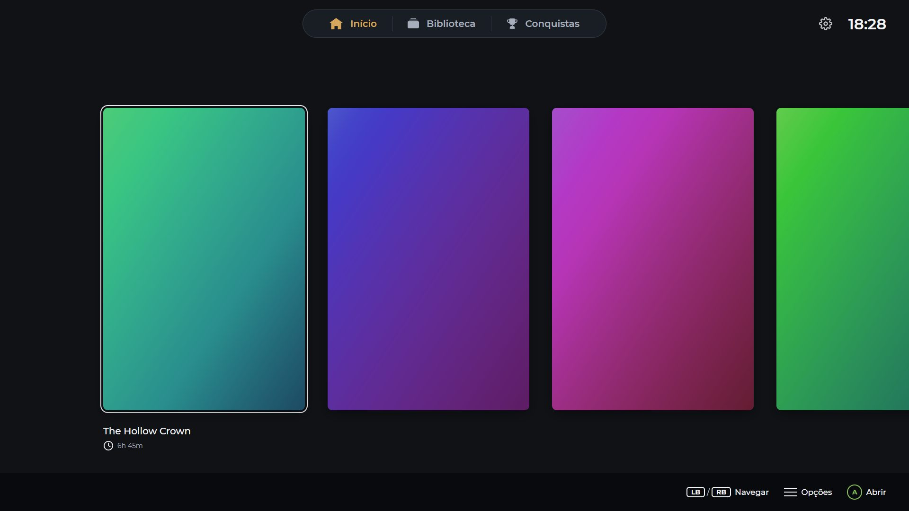
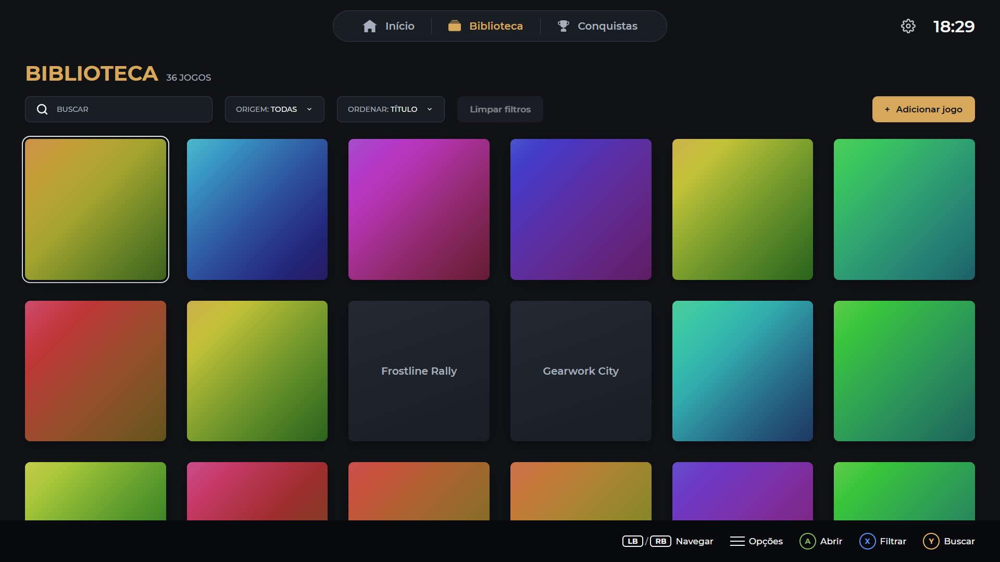
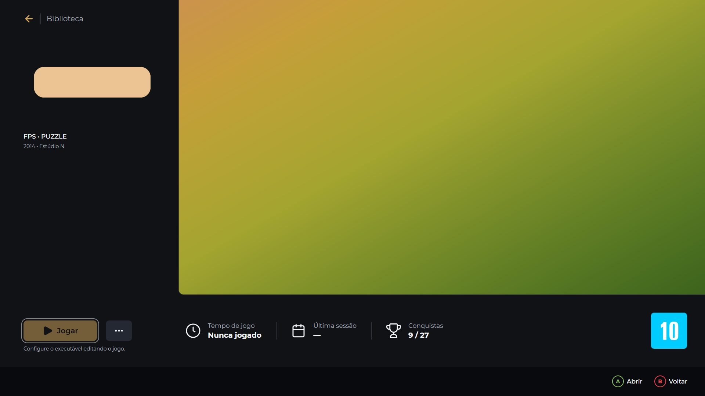
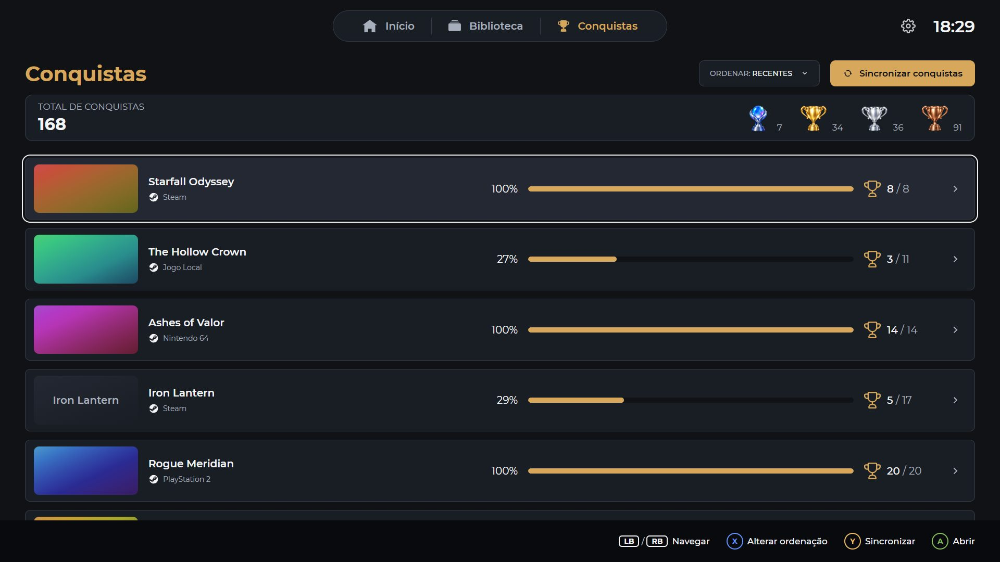
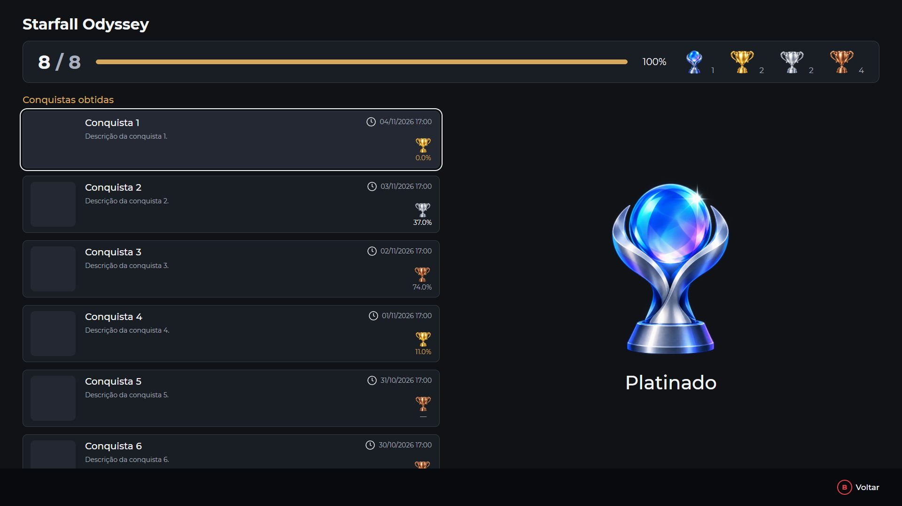

# Equon Game Launcher

A controller-first game launcher for Windows: your Steam library, your other PC games and your emulated games in one place, with a console-like experience. The interface is in Brazilian Portuguese.



*Screenshots use the built-in sample library, with fictional games and generated artwork.*

## Features

- **Controller first.** The whole app works with a gamepad, and also with keyboard and mouse. Focus is always visible, including at a distance on a TV.
- **Steam.** Games you own appear on their own, installed or not. Installing or removing a game in Steam shows up within seconds. Playtime and last session come from Steam, and sessions observed by the launcher add on top.
- **Other games.** Add a game with its name and executable, and confirm it on [IGDB](https://www.igdb.com) to fill in the rest (your own free Twitch app; descriptions come in English). Any store `.url` shortcut works too, which is how Epic Games Store and GOG games are added. Yuzu games only need the ROM. You can create your own origins, such as Nintendo 64.
- **Library.** Search, filters by origin and install state, hidden games, games marked as beaten, and sorting by title, recent activity or playtime.
- **Achievements.** Steam achievements by game, with rarity tiers and a platinum for completed games. A game is synced when it closes, and a manual action syncs the whole library.
- **Artwork.** Downloaded from Steam, IGDB and, with your own key, SteamGridDB, and kept on disk. In "Editar artes" you can change each image of any game, from IGDB, a SteamGridDB gallery or a file, or remove it; what you choose is never overwritten. Everything works with placeholders too.
- **Local and private.** One local user and an embedded SQLite database, with no account or server of its own. API keys are encrypted with Windows' own protection and never leave the main process.

| | |
| --- | --- |
|  |  |
|  |  |

## Limitations

- **Windows only**, with the Xbox controller layout. Validated at 1920×1080 and 1280×720.
- **The installer is not signed**, so Windows SmartScreen may warn and an antivirus may hold the program for a scan. There are no automatic updates: a new version is a new installer.
- **Epic Games Store, GOG and others have no automatic integration:** their games are added by hand. Yuzu is the only emulator with its own launch support.
- **Achievements come from Steam only.**
- **Steam Web API features need your own key, your SteamID and a public game list:** owned games that are not installed, playtime and achievements. Without them the launcher still finds installed games and opens them.
- **Playtime has limits:** programs that hand off to another launcher and exit right away are not timed, and neither are `.url` shortcuts.
- **Artwork takes disk space and time:** about 3 MB per game, and a large library takes a while to fill in the background. The cache is never cleaned automatically, and a game with no art available is only tried again through "Atualizar biblioteca".
- **Not done:** cloud sync, several users or several Steam accounts on one install.

## Tech Stack

Electron, React and TypeScript, built with electron-vite; SQLite through `better-sqlite3`, with hand-written SQL and versioned migrations; npm, Vitest, ESLint and Prettier. Decisions and their reasons are in [`docs/ARCHITECTURE.md`](docs/ARCHITECTURE.md).

## Local Setup

Requirements: Windows, Node.js **24.18.0** (see `.nvmrc`) and npm. No C++ toolchain is needed.

```sh
npm install      # installs dependencies and downloads the pinned Electron (44.10.2)
npm run dev      # starts the app with hot reload
```

| Script | What it does |
| --- | --- |
| `npm run dev` | Start the app in development mode |
| `npm run dev:seed` | Same, after replacing the dev library with ~40 sample games and generated artwork |
| `npm run build:win` | Create the installer in `dist/` |
| `npm run build` | Typecheck and build main, preload and renderer into `out/` |
| `npm start` | Preview the production build |
| `npm test` | Run the Vitest suite once |
| `npm run lint` | ESLint, including the layer-boundary rules |
| `npm run typecheck` | `tsc --noEmit` for the Node and web projects |
| `npm run format` | Prettier |

### Native module (`better-sqlite3`)

`better-sqlite3` 13 ships N-API prebuilt binaries, so the same binary works in Node (tests) and Electron (app) and **no rebuild is needed**. `tests/native/better-sqlite3.test.ts` checks both runtimes. If it ever fails with a load or `NODE_MODULE_VERSION` error, the package stopped shipping compatible prebuilds; that is a tooling problem, not a code bug (see `docs/ARCHITECTURE.md` §3.15).

### Manual games

Library → "Adicionar jogo": pick the game's `.exe` or a store `.url` shortcut, optional arguments, working folder and a 1920×1080 background. The launcher starts the executable directly and adds the time of each observed session to the game. Executables that hand off to another launcher and exit right away are not tracked, and `.url` shortcuts are never tracked (see `docs/ARCHITECTURE.md` §11).

Settings → "Emuladores": configure `yuzu.exe` once; Yuzu games then only need the ROM.

### Installing

`npm run build:win` creates `dist/equon-game-launcher-<version>-setup.exe`. Run it: it installs for the current user, with no administrator rights, and creates the shortcuts. To update, run the new installer over the old one.

Then, in Settings → "Conexões", fill in your SteamID and your [Steam Web API key](https://steamcommunity.com/dev/apikey), and optionally a [SteamGridDB key](https://www.steamgriddb.com/profile/preferences/api) and the Client ID and Secret of a [Twitch app](https://dev.twitch.tv/console) for IGDB. Your Steam game details must be public for the launcher to read them.

The installer is not signed: Windows SmartScreen may warn about it ("More info" → "Run anyway"), and an antivirus may hold the new program for a scan, so the first launch can take a while.

Your library stays in `%APPDATA%\equon-game-launcher`. Installing, updating and uninstalling never touch it. To recover from a backup, see `docs/DATA_BASE_CONTEXT.md` §6.

### Development data

Unpackaged runs (`npm run dev`, `npm start`) keep their data in `%APPDATA%\equon-game-launcher-dev`, separate from the real library (`%APPDATA%\equon-game-launcher`, used by the packaged app). `npm run dev:seed` only ever writes to the dev folder.

### Controls

Controller (Xbox layout): A confirm, B back, D-pad / left stick move, right stick scroll, LB/RB switch section, ☰ options. Keyboard: arrows, Enter/Space, Esc/Backspace, Page Up/Down, Q/E, M. Mouse: click to open, right click for options. Full table in `docs/DESIGN_SYSTEM.md` §8.

### Troubleshooting

- **The launcher takes long to open after installing:** an antivirus may be scanning the new unsigned program. This only happens on the first launch of each new version.
- **Owned games or playtime do not appear:** check Settings → "Conexões" → "Testar conexão". A private profile hides the game list.
- **The database cannot be opened:** the message says why and where the data is. Nothing was deleted; backups and how to restore them are in `docs/DATA_BASE_CONTEXT.md` §6.
- **`Cannot read properties of undefined (reading 'isPackaged')` on `npm run dev`:** the terminal has `ELECTRON_RUN_AS_NODE=1` set (VS Code's integrated terminal can set it). Clear it for the session: `Remove-Item Env:ELECTRON_RUN_AS_NODE` in PowerShell, or `unset ELECTRON_RUN_AS_NODE` in Git Bash.

## Documentation

- [`docs/PRODUCT.md`](docs/PRODUCT.md): product requirements and MVP scope.
- [`docs/ARCHITECTURE.md`](docs/ARCHITECTURE.md): architecture and decision log.
- [`docs/DATA_BASE_CONTEXT.md`](docs/DATA_BASE_CONTEXT.md): data model and integrity rules.
- [`docs/DESIGN_SYSTEM.md`](docs/DESIGN_SYSTEM.md): visual design system.
- [`docs/ROADMAP.md`](docs/ROADMAP.md): implementation phases.
